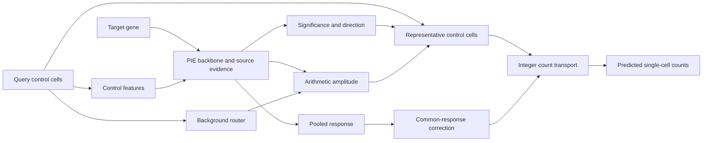

# Advaita_VirtualCell_Model

**Predicting single-cell transcriptional responses to genetic perturbations across cellular backgrounds.**

[](pyproject.toml)
[](LICENSE)
[](https://github.com/yfsong00/Advaita_Lab_VirtualCell_Model/actions/workflows/tests.yml)

[Overview](#overview) · [Quick start](#quick-start) · [Inference](#inference) · [Training](#training) · [Documentation](#documentation) · [Contributing](CONTRIBUTING.md)

## Overview

Advaita_VirtualCell_Model is a research implementation of the Advaita V20 pipeline for the Virtual Cell Challenge. Given a target gene and unperturbed cells from a query background, it predicts a distribution of perturbed single-cell RNA counts.

The method separates three quantities that need different supervision: **which genes respond, how strongly individual cells respond, and how the pooled population responds**. It combines an independently trained [PIE](https://github.com/ArcInstitute/pie) backbone with dedicated readouts, control-based specialist routing, source-derived response correction, and constrained integer count generation.

This repository contains training, inference, local evaluation, configuration examples, and a synthetic CPU demonstration. **Trained weights, expression datasets, source embeddings, and historical submission packages are not bundled.** Running the trained model requires the assets described in [Data and model assets](docs/assets.md).

### What is included

- **Foundation training:** random initialization, a complete pass over eligible source records, and laboratory-balanced fine-tuning.
- **Separate response objectives:** frozen significance/direction readouts, source-adapted arithmetic amplitude, and contrastive pooled-response training.
- **Background-specific amplitude:** a specialist selected from control expression, with source-retention and held-out-target checks.
- **Common-response correction:** a rank-64 source basis adjusts the shared response component while preserving centered target contrasts before reconstruction.
- **Count generation:** representative control cells, response-shape adjustment, and minimal-L1 integer transport with exact gene totals and preserved generated-cell library sizes.
- **Reproducible artifacts:** explicit gene/target axes, deterministic target seeds, count hashes, and validated H5AD assembly.



## Quick start

Use Python 3.12 on Linux. The core count pipeline runs on CPU; model training benefits from a CUDA GPU.

```bash
git clone https://github.com/yfsong00/Advaita_Lab_VirtualCell_Model.git
cd Advaita_Lab_VirtualCell_Model
python3.12 -m venv .venv
source .venv/bin/activate
python -m pip install -e .

advaita demo --output outputs/demo
```

The demonstration generates synthetic controls and response readouts, renders four targets, assembles `outputs/demo/predictions.h5ad`, and verifies a **96-cell × 48-gene** count matrix. It exercises the software pipeline; it does not demonstrate biological prediction accuracy.

Install optional capabilities as needed:

```bash
python -m pip install -e '.[model]'       # PIE model execution and training
python -m pip install -e '.[evaluation]'  # cell-eval DE and PDS diagnostics
python -m pip install -e '.[dev]'         # tests, formatting and packaging
```

The model extra pins the PIE source revision. Its dependency constraints may install a different PyTorch/NumPy stack from the historical training environment. See [Reproducibility](docs/reproducibility.md) for the distinction between algorithmic reproduction and count-level parity.

## Inference

Configure local assets and checkpoint locations in [`configs/assets.example.json`](configs/assets.example.json) and [`configs/infer.example.json`](configs/infer.example.json). Paths in a configuration file resolve relative to that file. The asset example shows the historical dataset/source names; every referenced directory must be supplied locally.

```bash
advaita infer --config configs/infer.example.json
advaita render --config configs/render.example.json --workers 1
advaita assemble --manifest outputs/counts/manifest.json \
  --output outputs/Advaita_VirtualCell_Model.h5ad
advaita validate --input outputs/Advaita_VirtualCell_Model.h5ad \
  --targets data/final/pert_counts.csv --genes data/final/gene_names.csv \
  --contexts D E F --cells-per-target 400
```

`infer` exports significance probabilities and LFC readouts. `render` combines the branches and writes one sparse count block per context/target. `assemble` checks each block's hash and streams the result into H5AD. `validate` checks gene order, target coverage, cell counts, and finite nonnegative integer expression.

The V20 recipe uses 400 generated cells per target and the full requested output gene axis. Unmodeled genes retain their control-derived bulk profile before final normalization. The renderer accepts cached control selections; remove `control_sets` from a context to recompute them. A new selection or a different target panel can change the output.

See the [inference guide](docs/inference.md) for input contracts, partial runs, memory considerations, and external challenge packaging.

## Training

Training is organized into four explicit stages. The example configurations reproduce the historical hyperparameters; source data, preprocessing, splits and embeddings must also match to reproduce the trained weights.

| Stage | Starting point | Updated parameters | Objective |
| --- | --- | --- | --- |
| Foundation | Random initialization | All modules | PIE multitask loss, dense LFC and distribution supervision |
| Source amplitude | Foundation | All modules, separate head/backbone learning rates | Multitask loss and significant-gene normalized error |
| Contrastive bulk | Foundation | LFC readout and LFC evidence adapter | Pooled-response MSE, cosine and target contrast |
| Specialist amplitude | Source amplitude | LFC readout and LFC evidence adapter | Deployed frozen-sign amplitude with label precision and teacher retention |

```bash
advaita train-foundation --config configs/train_foundation.example.json
advaita prepare-source --config configs/source.example.json
advaita train --config configs/train_amplitude.example.json
advaita train --config configs/train_bulk.example.json
advaita prepare-specialist --config configs/specialist_labels.example.json
advaita train --config configs/train_specialist.example.json
advaita fit-basis --config configs/basis.example.json
advaita fit-router --config configs/router.example.json
```

Each training stage writes `best.ckpt` under its configured output directory. Place the selected checkpoints at the paths in the inference configuration, or point inference directly to the training outputs. Training outputs are never committed to this repository.

The [method description](docs/method.md) gives the motivations, equations, sampling schedule, selection gates and a worked example. [Data and model assets](docs/assets.md) describes the source and specialist preparation formats.

## Evaluation

```bash
advaita evaluate --config configs/evaluate.example.json
```

Local evaluation compares predictions with held-out measured perturbations using a separate real-control reference. Predictions are subsampled to match the available real-cell count, without duplicating cells. Outputs include NMAE, direction REACH, cosine PDS and raw pseudobulk MSE, with eligible-target counts.

These are **local diagnostic components, not an official challenge composite score**. Background identities inferred from control similarity are hypotheses. The specialist routing rule was an exploratory extension after observing transfer differences, and the local panels were reused during development. See [Evaluation and limitations](docs/evaluation.md).

## Repository layout

```text
configs/                     Portable example recipes and artifact fingerprints
docs/                        Method, assets, inference and evaluation guides
src/advaita_virtualcell/
  training/                  Foundation and readout adaptation
  inference.py               Model readout export
  evidence.py                Missing-label and lineage-aware evidence handling
  routing.py                 Control-only specialist routing
  bulk.py                    Pooled response and shared-component correction
  renderer.py                Single-cell response-shape generation
  transport.py               Integer transport with exact marginals
  assembly.py                Validated sparse H5AD assembly
tests/                       Algorithmic, objective and pipeline tests
```

## Documentation

| Guide | Contents |
| --- | --- |
| [Method](docs/method.md) | Motivation, architecture, losses, schedules and examples |
| [Data and model assets](docs/assets.md) | Required files, source provenance and array contracts |
| [Inference](docs/inference.md) | Configuration, rendering, validation and packaging |
| [Evaluation](docs/evaluation.md) | Panel design, metrics and practical limitations |
| [Reproducibility](docs/reproducibility.md) | Environment, artifact fingerprints and parity checks |

## Development

```bash
python -m pip install -e '.[dev]'
python -m pytest
ruff check .
ruff format --check .
python -m build
```

Training-objective tests run when PyTorch is installed. Tests use synthetic data; production datasets and checkpoints are not required. Contributions should include a focused test when changing count conservation, routing, readout semantics or training objectives. See [CONTRIBUTING.md](CONTRIBUTING.md).

## Citation

```bibtex
@software{advaita_virtualcell_model,
  author = {{Advaita Lab}},
  title = {Advaita_VirtualCell_Model},
  year = {2026},
  url = {https://github.com/yfsong00/Advaita_Lab_VirtualCell_Model}
}
```

Please also acknowledge PIE and the original data providers when using their architecture, assets or datasets. This repository does not imply endorsement by those providers.

## License

This work is distributed under [CC BY-NC-SA 4.0](LICENSE), consistent with the upstream PIE license. Attribution, noncommercial use and share-alike requirements apply. Dataset, embedding and dependency licenses remain separate. See [Third-party notices](THIRD_PARTY_NOTICES.md) for attribution and the pinned upstream revision.
